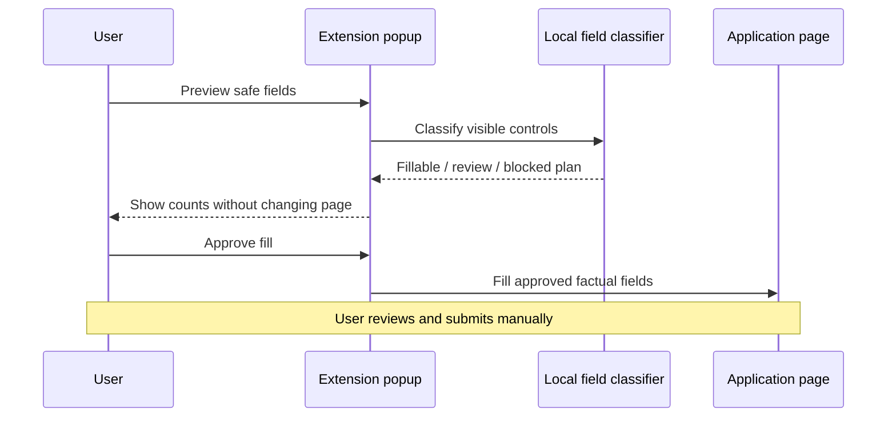

# Safe Application Prefill

[](https://github.com/HimavanthMahesh/safe-application-prefill/actions/workflows/ci.yml)
[](manifest.json)
[](LICENSE)

A local Chrome/Chromium extension that previews and fills a deliberately small set of factual job-application fields on Greenhouse, Lever, and Ashby. The user must preview the plan and remains responsible for reviewing every value and submitting the application.

The extension is designed to fail closed. It cannot click submit controls, upload files, fill passwords, answer CAPTCHAs, accept legal attestations, or populate protected demographic fields. Work-authorization and visa-sponsorship questions are deliberately left for manual review.

## Design goals

- Reduce repetitive typing without hiding what will change.
- Restrict access to a small, explicit ATS hostname allowlist.
- Keep candidate data local—no analytics, remote API, model provider, or credential handling.
- Treat unknown and high-impact questions as review items instead of guessing.
- Prove the no-submit boundary with automated browser tests.



## Supported sites

| ATS family | Allowed hostname |
| --- | --- |
| Greenhouse | `boards.greenhouse.io`, `job-boards.greenhouse.io` |
| Lever | `jobs.lever.co` |
| Ashby | `jobs.ashbyhq.com` |

The extension does not request `<all_urls>` access.

## Safety boundary

### Eligible for preview and fill

- Name, email, phone, and basic address fields
- LinkedIn and GitHub URLs
- Current company and title
- School, degree, and field of study
- Relocation preference

### Always blocked or left for review

- Submit, file-upload, password, hidden, image, and reset controls
- Race, ethnicity, gender, disability, veteran, religion, age, date of birth, and government identifiers
- CAPTCHAs, signatures, certifications, acknowledgements, and legal terms
- Work authorization, immigration, visa, and sponsorship questions
- Unknown questions and unsupported controls

## Install locally

This is an unpacked development extension, not a Chrome Web Store release.

1. Clone or download this repository.
2. Copy `candidate-profile.example.json` to `candidate-profile.local.json`.
3. Replace only the example values with your factual information. The local file is ignored by Git.
4. Open `chrome://extensions` in a dedicated Chromium profile.
5. Enable **Developer mode**, choose **Load unpacked**, and select this repository folder.
6. Keep the extension disabled outside job-application sessions.

## Use

1. Open a supported application page.
2. Open the extension and select the synthetic or local profile.
3. Choose **Preview safe fields**. Preview does not change the page.
4. Review the fillable, review, and blocked counts.
5. Choose **Fill previewed fields**.
6. Review every populated value, answer withheld questions yourself, upload the correct resume, and submit manually.

Changing the active tab or profile invalidates approval and requires a new preview.

## Test

Requirements: Node.js 22 or newer.

```bash
npm install
npm test
```

The browser integration suite exercises 30 synthetic application pages—ten variants for each supported ATS family—and verifies that preview changes no fields, protected fields remain empty, pages outside the allowlist are denied, and zero submissions occur.

## Architecture

- `core.js` contains the deterministic URL and field-classification rules.
- `content.js` builds and applies the plan inside an allowed application page.
- `popup.js` enforces preview-before-fill and invalidates approval when context changes.
- `manifest.json` defines the narrow host permissions.
- `tests/` contains unit-level safety assertions and full browser integration checks.

## Scope and limitations

- ATS forms change frequently; real pages may require new selectors or field rules.
- This pilot does not support Workday, iCIMS, Taleo, SmartRecruiters, or arbitrary employer sites.
- It does not upload resumes, generate answers, apply automatically, or contact recruiters.
- It is not a password manager and should never store account credentials.
- It has not undergone an independent security audit.

See [THREAT_MODEL.md](THREAT_MODEL.md) for the security boundary and [SECURITY.md](SECURITY.md) for private vulnerability reporting.

## License

[MIT](LICENSE)
